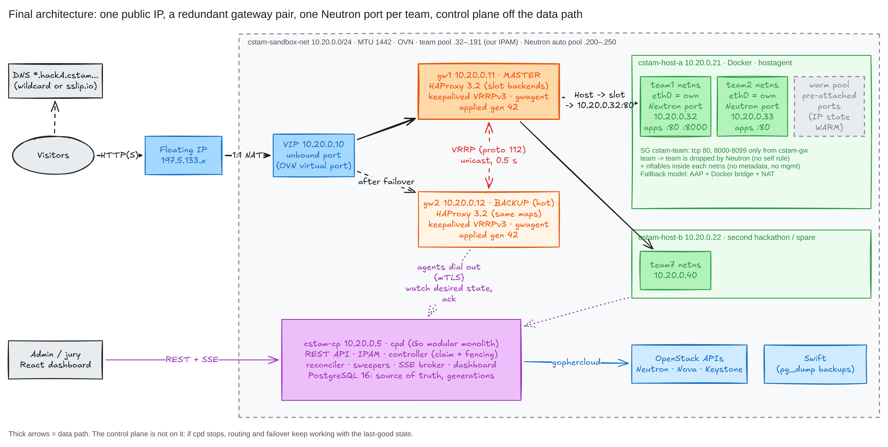
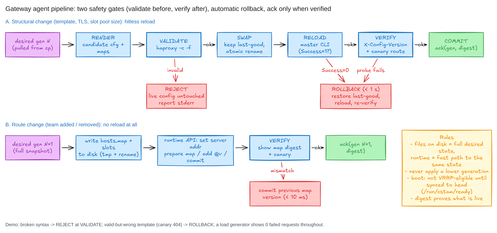
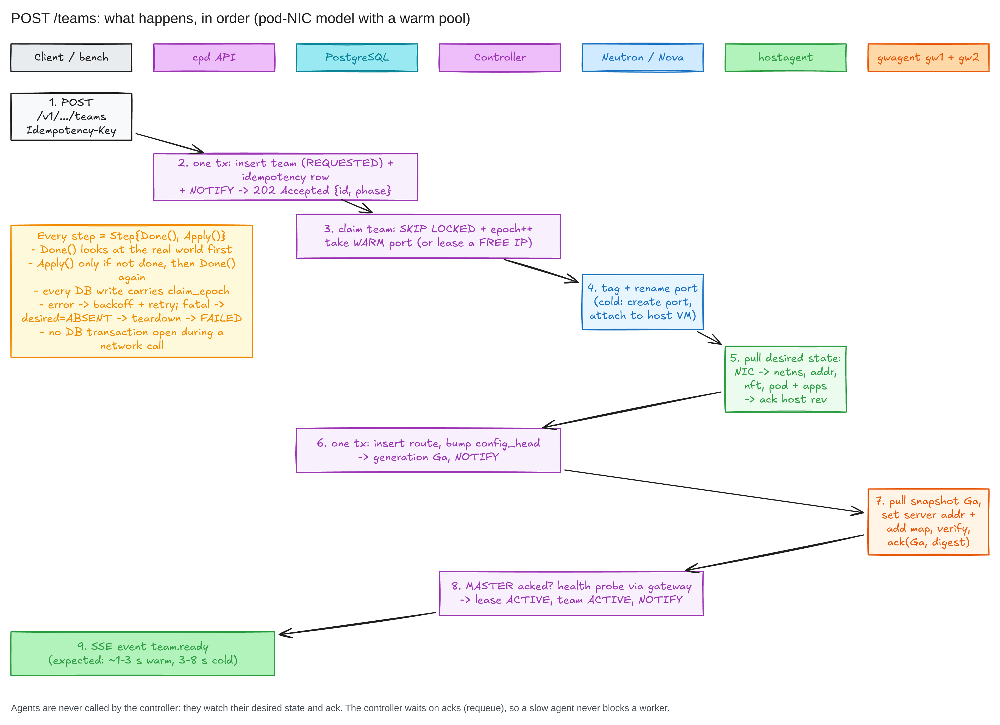
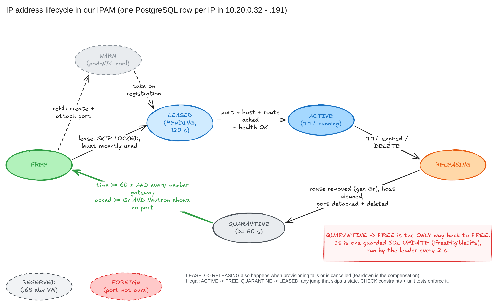

# Architecture

## 1. Overview

One public floating IP, a redundant pair of gateways sharing a virtual IP, one private IP per team,
and a control plane that is **not on the data path**: if `cpd` stops, routing and failover keep
working with the last applied state.



The diagram shows the target design. What is built today (Phase 1) differs in three points:
- Team sandboxes are **one small VM per team** (`G0.basic.1c1g`) on a Neutron port carrying the
  team's IPAM address. The shared Docker hosts with per-team network namespaces (`hostagent`) are
  the Phase 2 design for more teams than the instance quota allows.
- Agents talk to `cpd` over **plain HTTP JSON with a bearer token** (long-poll + ack), not mTLS.
- No SSE dashboard yet (Phase 3).

| Address (10.20.0.0/24, `cstam-sandbox-net`) | Role |
|---|---|
| .1 | Neutron router (SNAT to the internet) |
| .5 | `cstam-cp`: `cpd` + PostgreSQL |
| .10 | VIP, an unbound Neutron port, held by the MASTER gateway; the floating IP maps to it |
| .11, .12 | `cstam-gw1`, `cstam-gw2` |
| .32 - .191 | team pool, allocated by our IPAM (never by Neutron) |
| .200 - .250 | Neutron's own allocation pool (never used by us) |

The plan lives in `internal/config/topology.go`, `infra/topology.env` and `infra/pulumi/config.go`.
Static infrastructure (network, router, security groups, VIP port, gateways, control plane) is
created by Pulumi (`infra/pulumi`, stack `prod`). Team resources are created at runtime by `cpd`.

## 2. Components

| Component | Code | Job |
|---|---|---|
| `cpd` | `cmd/cpd`, `internal/api`, `internal/lifecycle`, `internal/ipam`, `internal/store` | REST API, team state machine, IPAM, reconciler. PostgreSQL is the source of truth. |
| Sandbox drivers | `internal/openstack` (gophercloud), `internal/docker` (docker CLI) | Create/delete the team sandbox at its fixed IP; idempotent by name `cstam-<hackathon>-<team>` |
| `gwagent` | `cmd/gwagent`, `internal/gw/agent` | On each gateway: long-polls the desired routes from `cpd`, applies them to HAProxy, acks the generation and reports the VRRP state |
| Applier | `internal/gw/applier`, `internal/gw/haproxy` | Renders `haproxy.cfg` and map files, changes routes at runtime, reloads safely, rolls back |
| keepalived config | `internal/gw/keepalived` | VRRPv3 unicast between gw1 (priority 150) and gw2 (100), `nopreempt`, health script, notify script |

## 3. HA gateway data flow

```
visitor --HTTP--> floating IP --1:1 NAT (OVN)--> VIP 10.20.0.10 --> MASTER gateway
   MASTER HAProxy frontend:
     Host header -> hosts.map -> be_slotNNN -> server = team IP:app_port   (data path)
   gwagent <--long-poll desired / POST ack--> cpd                          (control path)
   keepalived <--VRRP adverts every 0.5 s--> peer keepalived              (failover)
```

**Routing.** HAProxy has 128 backends `be_slot001..128`, each with one server. Publishing a team
sets that slot's server address with the runtime API and swaps the `hosts.map` atomically (a
versioned map swap). No reload is needed to add or remove a team: a new team is routed 24 ms
after `cpd` publishes it (benchmark B2). Unknown hosts get a 404 page, a team whose sandbox is down
gets a maintenance page, and each `Host` is rate limited.

**Desired state and acks.** Every change of the published routes increases a global
`routes_generation` in PostgreSQL. A gateway always applies the whole table of one generation,
never a diff, and never an older generation than the one it serves. It acks only a generation it
has applied, and it saves the table to `/var/lib/cstam/desired.json` so a restart serves the same
routes even without `cpd`.

**Readiness.** At start `gwagent` deletes `/run/cstam/ready` and recreates it only after a
successful sync with `cpd` (or after 10 s without `cpd`, as `stale`). keepalived's `chk_gateway`
needs that file **and** a 200 from HAProxy's own `/__gw/healthz`, so a freshly started gateway
does not take the VIP before it has routes. If `cpd` is down, the gateway becomes ready after 10 s
with the routes it saved before (better than no gateway at all); it catches up when `cpd` returns.

**Failover** ([diagram](../guide/diagrams/f07-vip-failover.png)):
- MASTER silent (crash, freeze): the backup declares it dead after 3 x 0.5 s + skew, takes the VIP
  and sends gratuitous ARPs; OVN moves the virtual port binding and the floating IP follows.
- HAProxy dies or stops answering: `chk_gateway` fails twice (interval 1 s), the gateway goes FAULT
  and gives up the VIP. On the VMs `vrrp_track_process` also reacts at once when the process dies.
- Manual failover: write `1` to `/run/cstam/force-backup`.
- `nopreempt`: a gateway that comes back stays BACKUP, so there is no second switch.
- Open TCP connections on the failed gateway are lost (HAProxy is a full proxy); every new
  connection succeeds after the gap.

## 4. Safe reload and rollback



Config changes (not route changes) go through the applier: render -> `haproxy -c` (rejected configs
never reach HAProxy) -> atomic file swap -> `reload` on the master CLI (HAProxy 3.2 answers
`Success=1` only when the new workers loaded) -> verify through the real frontend
(`/__gw/healthz` must show the new `X-Config-Version`, and the canary backend must answer) ->
if anything fails, restore the last good config and reload again. Old workers finish their
connections, so a reload drops no request (benchmark B1).

## 5. Team lifecycle and IPAM



`POST /v1/hackathons/{h}/teams` inserts the team and allocates its IP and slot **in the same
transaction** (lowest free IP, lowest free slot, under an advisory lock so concurrent requests never
get the same one), then answers `202` with the team in state `provisioning`. A worker
(`cpd -workers`, default 4) creates the sandbox at that IP, then marks the team `ready` and bumps the
routes generation: both gateways route it within milliseconds.

States: `provisioning -> ready | failed -> deleting -> deleted`. A failed team keeps its name and
slot for 10 minutes so the error can be read, then it is cleaned up.



**Reclamation** ([diagram](../guide/diagrams/f12-teardown-acks.png)). A team is deleted when its
lease expires (`lease_ttl_seconds` of the hackathon), when
an admin deletes it, or when its hackathon ends (`POST /v1/teams/{id}/renew` resets the lease to
now + TTL). Order:
1. the route is removed and the routes generation bumped, in the same transaction that puts the
   IP in `quarantine` with `released_gen` = that generation;
2. the sandbox is deleted;
3. the sweep (every 2 s) frees the IP only when it has been quarantined for 60 s, **every gateway
   seen in the last 5 minutes acked a generation >= `released_gen`**, and the driver says no
   resource still holds the IP (Neutron port check).

This is what makes aggressive recycling safe: no gateway can still send traffic for the old team
to an address that a new team now uses. Every IP change writes an `events` row.

## 6. Security

- **Isolation between teams**: the `cstam-team` security group only accepts TCP 80 and 8000-8099
  from the `cstam-gw` group, and has no "self" rule, so Neutron drops team-to-team traffic. Teams
  cannot reach each other, the gateways' management, or the control plane.
  (The local Docker demo does not reproduce this: all containers share one bridge.)
- **Gateways**: VRRP (IP protocol 112) only between gateway ports (`cstam-vrrp` group);
  `/__gw/*` endpoints answer only to internal sources (localhost, cp, gateways).
- **Control plane**: admin and gateway tokens are different, compared in constant time, and only
  read from the environment. Internal errors are never returned to clients. The OpenStack
  credential is an application credential, used only by `cpd`; agents never import gophercloud or
  pgx (enforced by the linter).
- **Input validation**: every name that reaches HAProxy, Docker or OpenStack must match
  `^[a-z0-9]([a-z0-9-]{0,30}[a-z0-9])?$`; images are checked against a strict reference pattern;
  external commands run with argv lists, never through a shell.
- **Resource ownership**: we only create, touch and delete resources named `cstam-*` (the OpenStack
  project is shared). The sandbox drivers refuse to delete anything else.
- **Team containers (docker driver)**: memory, CPU and pids limits, `no-new-privileges`, all
  capabilities dropped for the default page.
