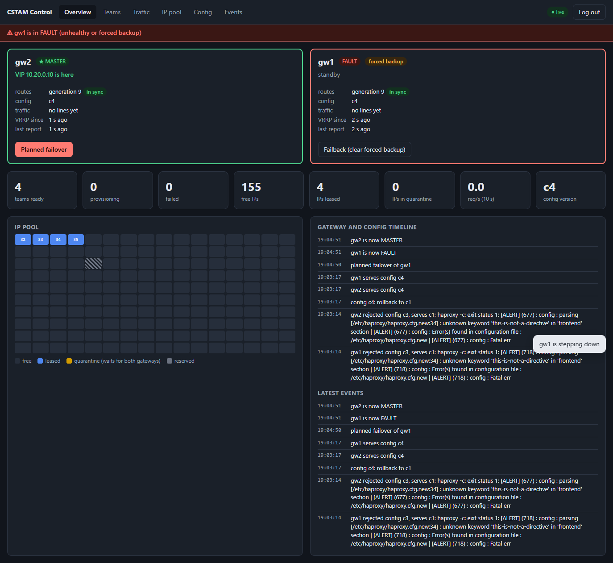
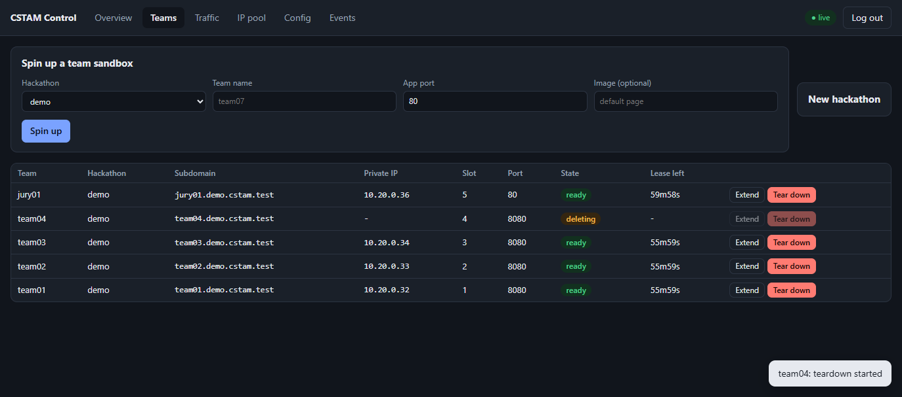
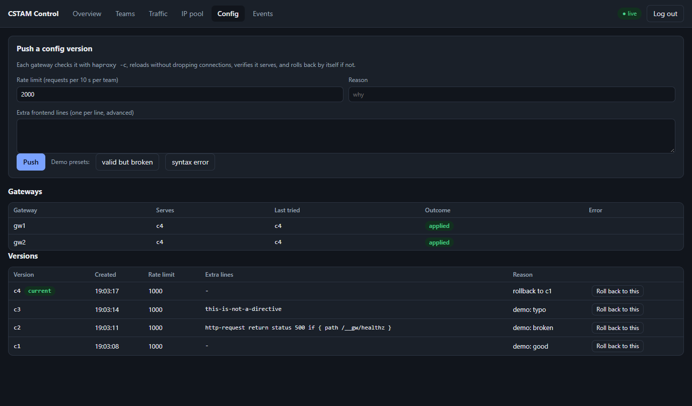
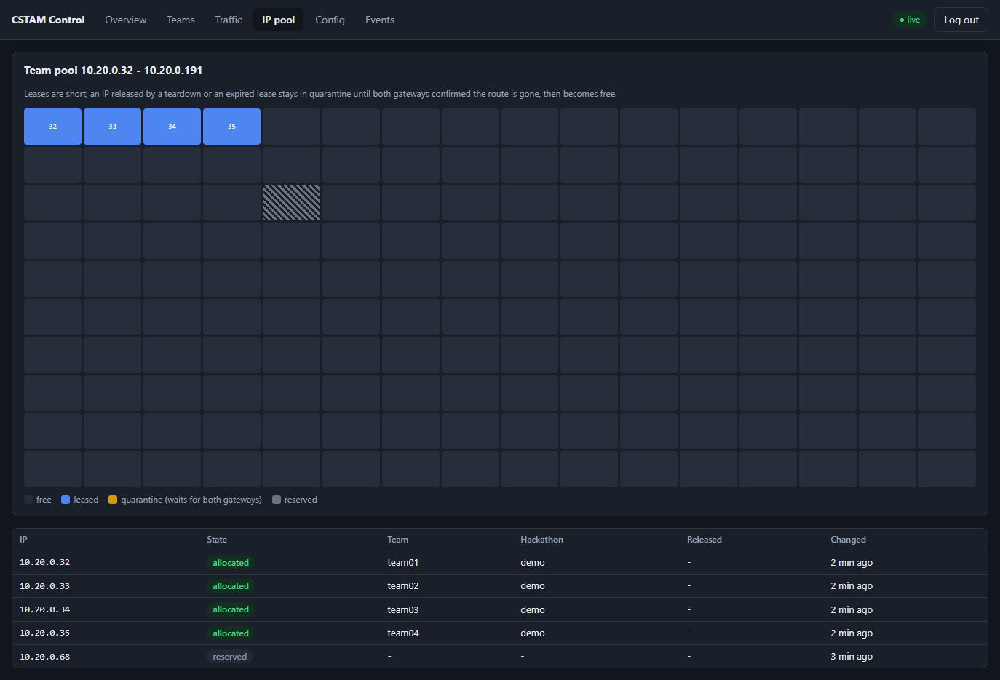

# Administrator dashboard

The dashboard is served by `cpd` itself at `/` (same port as the API, 8443). It is plain HTML,
CSS and one JavaScript module in `web/dashboard/`, embedded in the binary with `go:embed`: no
Node toolchain, no build step, nothing to deploy beside `cpd`.

**Rule: the dashboard has no business logic.** Every value it shows and every warning it raises
comes from the REST API ([api.md](api.md)); every button calls one API endpoint that `curl` or
`cstamctl` can call too. Gateway health (`alive`, `in_sync`), alerts (split brain, no master,
gateway behind or silent, config refused) and request rates are computed by `cpd`.

## Opening it
```bash
make build && deploy/dev/demo.sh up && deploy/dev/demo.sh teams 4
# browser: http://10.20.0.1:8443/   token: $XDG_RUNTIME_DIR/cstam-demo/admin.token
```
On FelCloud: `http://<cp floating IP>:8443/` (security group `cstam-cp`). The login asks for
the admin token; it stays in the tab's session storage and is sent only to this server.
Known gap: `cpd` speaks plain HTTP, so on FelCloud open the dashboard through an SSH tunnel
(`ssh -L 8443:10.20.0.5:8443 cp`, then `http://localhost:8443/`) until TLS is added.

## Pages and what the brief asks for

| Brief (Phase 3) | Where |
|---|---|
| Active team sandboxes and their OpenStack private IPs | **Teams** (name, hackathon, subdomain, private IP, slot, state, lease countdown); **IP pool** grid |
| Real-time gateway health, primary vs standby | **Overview**: the MASTER card is always first, with "VIP 10.20.0.10 is here", a green border and a star (not color alone); routes generation and sync, config version, req/s, last report; a red banner for every alert |
| Mapped subdomains and live traffic logs | **Teams** (subdomain per team); **Traffic**: live lines (time, gateway, client, host, method, path, status, time, backend slot), filter by host, pause, req/s and 5xx per gateway |
| Manual lifecycle controls | spin-up form and tear down (type the team name to confirm) on **Teams**; extend lease; **Planned failover** / **Failback** on each gateway card; **Config**: push a version, roll back to any version, demo presets for a broken config |









## Manual controls, end to end

| Button | API | What happens | Measured |
|---|---|---|---|
| Spin up | `POST /v1/hackathons/{h}/teams` | IPAM lease, sandbox, route on both gateways | team ready ~0.5 s after the click (local Docker driver), notebook L13 |
| Tear down | `DELETE /v1/teams/{id}` | sandbox deleted, route removed, IP to quarantine until both gateways ack, then free | notebook L6 |
| Planned failover | `POST /v1/gateways/{gw}/failover` | agent writes keepalived's force-backup file, the gateway goes to FAULT, the peer takes the VIP; refused if the peer is not healthy and in sync | VIP moved in 0.30-0.31 s, 1 probe of ~175 lost (L10) |
| Failback | `POST /v1/gateways/{gw}/failback` | the gateway returns as BACKUP (`nopreempt`) | L10 |
| Push config / Roll back | `POST /v1/config`, `POST /v1/config/{v}/rollback` | check, hitless reload, verify, auto-rollback on each gateway; rollback = new version with old content | broken version rolled back in 139 ms (0.80 s total), typo rejected in 23 ms, 0 failed requests (L11) |

## Live updates
The page polls the API every second (`/v1/status`, `/v1/teams`, `/v1/traffic?after=`), the IP
pool and events every 2 s, hackathons and config versions every 5 s, and stops while the tab is
hidden. The "live" pill turns red with the time of the last good answer when `cpd` stops
answering, and a banner says the data may be old. Polling was chosen over server-sent events:
the browser sends the token in a header (an `EventSource` cannot), and one second is far below
what a person watching a failover notices.

## Security
- Same origin as the API, bearer token, no cookies (so no CSRF surface).
- Two roles: the **admin** token, and an optional **viewer** token (`CSTAM_VIEWER_TOKEN`) for the
  jury: every page live, a "read-only" badge, no form and no button; the API answers 403 to any
  write with it (`TestViewerToken`), so hiding the buttons is comfort, not the protection.
- `Content-Security-Policy: default-src 'none'; script-src 'self'; ...; frame-ancestors 'none'`,
  plus `nosniff`, `X-Frame-Options: DENY`, `Referrer-Policy: no-referrer`.
- Every value is inserted as text (`textContent` / text nodes). Host headers and paths in the
  traffic log come from the internet, so `web_test.go` fails the build if `app.js` uses
  `innerHTML`, `outerHTML`, `insertAdjacentHTML`, `document.write`, `eval` or `new Function`,
  and if `index.html` has an inline script or inline event handler.
- Destructive buttons say the consequence in plain words; teardown needs the team name typed.

## Tests
`go test ./web/` (assets, headers, no HTML injection, every element id used by the script
exists). The flows were driven in a real browser (headless Edge over the DevTools protocol)
against the local demo stack: login, every tab, planned failover by click, spin-up by form,
teardown by typed confirmation (notebook L13).
