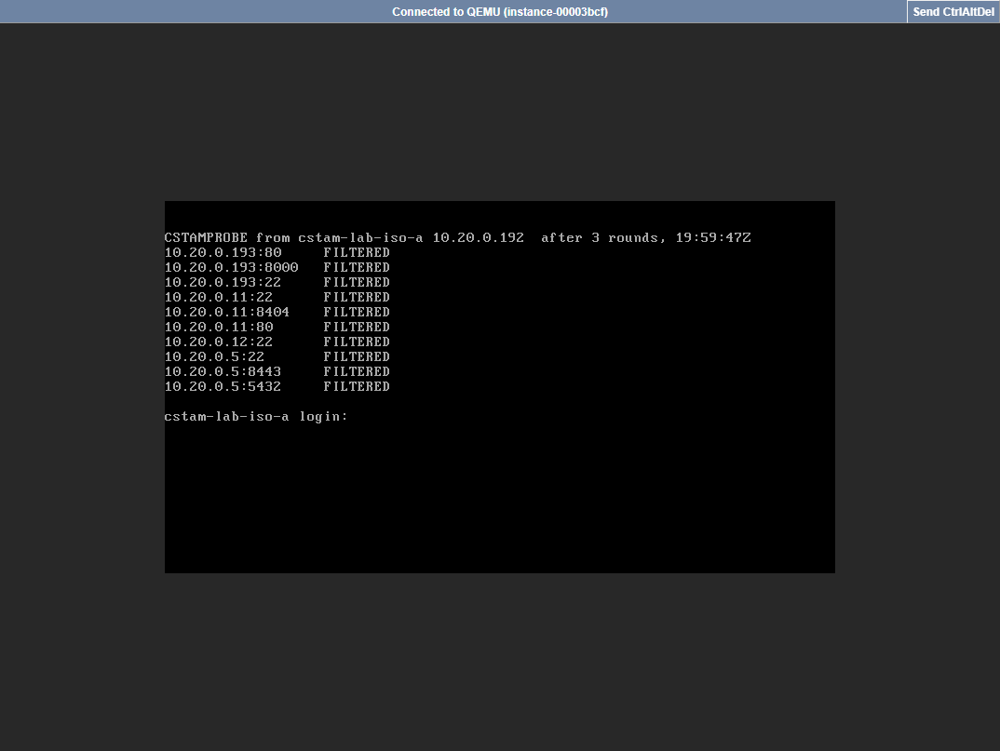
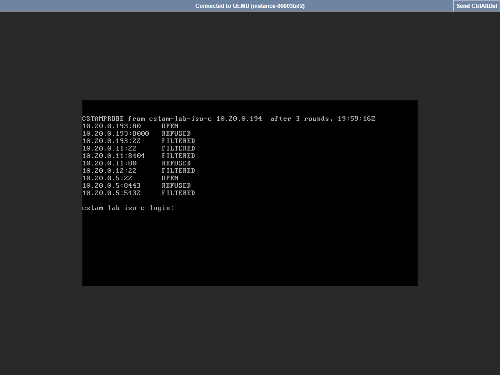

# Phase 2 validation: integration and testing (30 points)

How each Phase 2 requirement of the [brief](../challenge/brief.md) was validated, with the command
that reproduces it and the measured result. Run on 2026-10-20: the local stack (real HAProxy 3.2,
keepalived, PostgreSQL 18, our binaries, FelCloud IP plan on a Docker bridge) and **FelCloud
itself** for network isolation. Details per run in the
[lab notebook](../notebook/experiments.md) (L14, L15).

| Requirement | Points | Verdict |
|---|---|---|
| Concurrent provisioning stress test, 10+ simultaneous teams | 15 | **pass**: 20/20 and 50/50, 0 errors |
| Automated teardown and lifecycle security | 10 | **pass**: expiry and hackathon end purge sandboxes, routes and IPs with nobody involved |
| Network isolation and access safeguards | 5 | **pass on FelCloud**: team-to-team and team-to-management traffic dropped by Neutron; gateways still reach teams |
| Deliverable: benchmark report | | [benchmark.md](benchmark.md) (B1-B9) |
| Deliverable: API integration and security architecture docs | | [api.md](api.md), [openapi.yaml](openapi.yaml), [security.md](security.md) |

## 1. Concurrent provisioning stress test (15)

`deploy/dev/demo.sh stress N` sends N team registrations to the API at the same time, then waits
until each team answers **through the VIP with its own page**: sandbox created, private IP leased,
route published on both gateways.

| N at once | API answers | Routed | Rejected | Distinct IPs / slots | Call to own page through the VIP |
|---|---|---|---|---|---|
| 20 | all in 254 ms | **20/20** | 0 | 20 / 20 | p50 1.9 s, p95 3.1 s, max 3.1 s |
| 50 (with 24 teams already running) | all in 328 ms | **50/50** | 0 | 50 / 50 | p50 4.0 s, p95 7.0 s, max 7.0 s |

After each run: both gateways acknowledged the same routes generation (82), `/v1/status`
had no alert. Uniqueness under contention is also proven at the database level: 1000 parallel
allocations on 128 slots never gave an IP or slot twice (benchmark B3).
On FelCloud a sandbox is a VM (23 s to ACTIVE, B4); the project quota (10 instances) limits a
VM run to about 6 teams, which is why the 10+ run uses the container driver: same API,
controller, IPAM and gateways.

## 2. Automated teardown and lifecycle security (10)

| Trigger | Command | Result |
|---|---|---|
| Hackathon ends | `HACK=stress50 deploy/dev/demo.sh teardown` | 50 sandboxes deleted in **6.9 s**; routes removed first; the 50 IPs in quarantine, all **free at 63 s**; 0 routes left, a deleted team's subdomain answers **404**, 0 leftover containers |
| Lease expires (nobody acts) | hackathon with `lease_ttl_seconds: 30`, 3 teams | at the expiry second: IPs quarantined, routes removed (200 -> **404**), teams deleted 1 s later |
| Failed provisioning | (tests) | failed team cleaned after 10 min, its sandbox deleted (`TestCreateFailureCleansUp`) |

Why it is safe ("sanitizing IP allocations"): an IP goes back to the pool only when (1) its route
was removed in the same transaction that released it, (2) **every live gateway acknowledged** a
routes generation without it, (3) 60 s of quarantine passed, (4) the cloud says no port still
holds it. So no gateway can still send a user to a recycled IP (`TestGatewayAckGatesRecycling`,
`TestIPTakenStaysQuarantined`). Every step is an event in `/v1/events` and on the dashboard.

## 3. Network isolation and access safeguards (5)

**On FelCloud, without floating IPs.** Three throwaway VMs `cstam-lab-iso-*` (lab range
.192-.194): **A** and **B** in `cstam-team` like any team sandbox (B serves a page on port 80),
**C** in `cstam-gw` like a gateway. At boot, A and C try a TCP connection to each target three
times and show the result on their screen, read through the noVNC console.
OPEN = connected, REFUSED = reachable but nothing listens, FILTERED = dropped by Neutron.

| From \ to | team B :80 / :8000 / :22 | gw :22, :8404 (management) | gw :80 (public entry) | cp :22 (SSH) | cp :8443 (API) | cp :5432 (DB) |
|---|---|---|---|---|---|---|
| team A, before the fix | FILTERED / FILTERED / FILTERED | FILTERED | REFUSED | **OPEN** | FILTERED | FILTERED |
| team A, after the fix | FILTERED / FILTERED / FILTERED | FILTERED | FILTERED | **FILTERED** | FILTERED | FILTERED |
| gateway-like C (control) | **OPEN** / REFUSED / FILTERED | FILTERED | REFUSED | OPEN | REFUSED | FILTERED |

- Teams cannot reach each other on any port; the gateway group can reach team app ports, so the
  FILTERED results are the security group at work, not a dead VM.
- Gateway management (SSH, stats) only answers the control plane; `cpd` only the agents.
- **Found and fixed:** the control plane's SSH is open to admins from anywhere (key-only), so a
  sandbox could reach it. Security groups can only allow, so `cstam-team` now has **no default
  egress**: it may open connections to anything outside 10.20.0.0/24 (internet, metadata
  service) and nothing inside it (`infra/pulumi/egress.go`, 24 prefixes computed from the IP
  plan, unit-tested). Replies to the gateways need no rule (stateful). Re-measured: everything
  internal FILTERED from a team, the gateway still reaches the team page.




Also verified on real HAProxy (`go test -tags integration -run TestGatewayGuards ./internal/gw/applier/`):
`/__gw/*` (health and version) is a silent 404 from outside addresses, a flooded team gets 429
while another team keeps answering, and `A.HACKA.TEST:80` does not bypass the per-team limit.
Under load: one team at ~79,000 req/s, the 19 others 0 errors, p99 3.7 ms (benchmark B8).

## Reproduce
```bash
make build && deploy/dev/demo.sh up
HACK=stress20 deploy/dev/demo.sh stress 20
HACK=stress50 deploy/dev/demo.sh stress 50
HACK=stress50 deploy/dev/demo.sh teardown
go test -count=1 -tags integration -run TestGatewayGuards ./internal/gw/applier/
# FelCloud isolation lab: notebook L14 (cloud-init files, commands, cleanup)
```

## What is left for the FelCloud run (needs public IPs from FelCloud)
The same checks through the real public entry once floating IPs exist: a team page through
`*.cstam.felcloud.tn`, failover with OVN, VM-based stress up to the quota. Isolation itself does
not depend on them and is already measured above.
